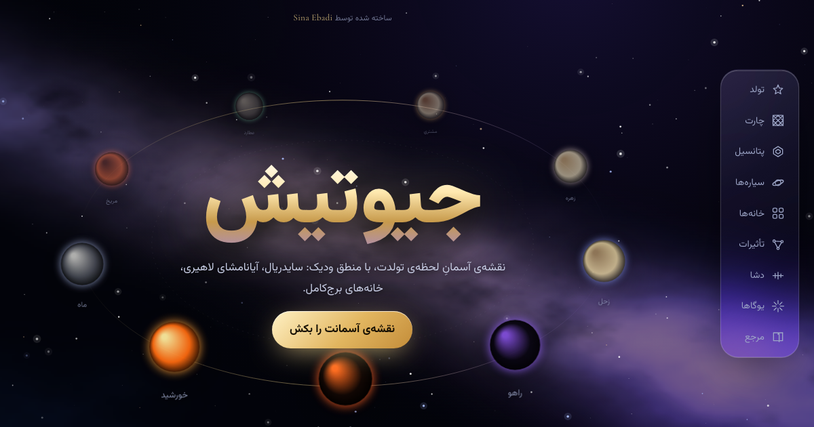
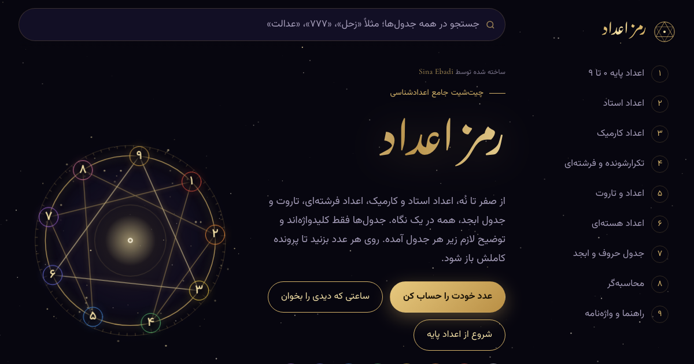
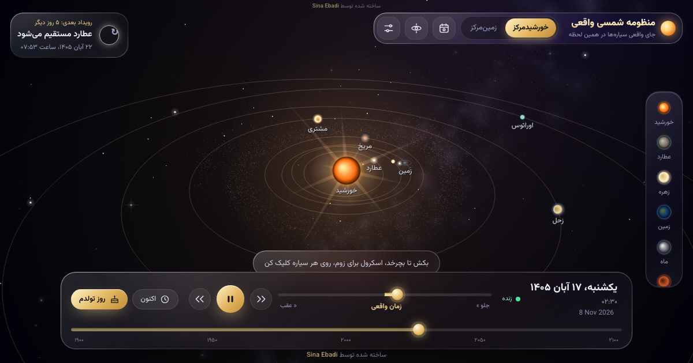

# Vibe Astro


Three small web projects built by **vibe coding**: I directed the design, tested,
and decided what to keep; the AI ([Claude](https://claude.ai)) wrote most of the
code. Each project is **one HTML file** with no build step, no install and no
dependency on the others. Open it and it works, even offline (fonts fall back to
system fonts).

Every page is in **Persian and English**. On the first visit it asks which one you
want and remembers your choice; Persian is the default.

**Live:** https://cnaebadi.github.io/vibe-astro/

| | Project | What it does |
|---|---|---|
| [](https://cnaebadi.github.io/vibe-astro/jyotish/) | **[Jyotish](https://cnaebadi.github.io/vibe-astro/jyotish/)** · جیوتیش | A Vedic (sidereal, Lahiri) birth chart: North and South Indian charts, D1 and D9, the nine grahas, twelve houses, aspects, Vimshottari dasha, yogas and a life-potential score. |
| [](https://cnaebadi.github.io/vibe-astro/ramz-adad/) | **[Number Codes](https://cnaebadi.github.io/vibe-astro/ramz-adad/)** · رمز اعداد | A numerology cheat sheet: base, master and karmic numbers, angel numbers, the tarot Major Arcana, Pythagorean, Chaldean and Abjad tables, a calculator and a time/number reader. |
| [](https://cnaebadi.github.io/vibe-astro/solar-system/) | **[The Real Solar System](https://cnaebadi.github.io/vibe-astro/solar-system/)** · منظومه شمسی واقعی | A 3D solar system with the planets where they really are, a time machine (1800–2200), a geocentric view with the zodiac, and a calendar of eclipses, conjunctions and retrogrades. |

## How it works

- **One file each.** HTML, CSS and JavaScript are inline. The only outside request
  is Google Fonts, and the pages work without it.
- **Real astronomy, in the page.** Planet positions use Paul Schlyter's method with
  perturbation terms for the Moon, Jupiter, Saturn and Uranus. Against reference
  values from Meeus' *Astronomical Algorithms* the error is under 0.02°.
- **Time zones.** Birth times are converted with the city's own IANA time zone,
  including historical daylight saving (Iran's on/off history, for example), so
  the chart is the same wherever the visitor is.
- **Near-sign-edge warning.** Jyotish flags a planet or ascendant that a few
  minutes of birth-time error could move into the next sign.
- **Two languages.** The Persian text stays in the code. In English mode a small
  engine at the end of each file swaps the displayed text using an English
  dictionary; the calculations are not touched.

## Run it locally

Download any `*/index.html` and open it in a browser. That's all.

## Tests

```bash
cd tests
npm install   # playwright-core only; it drives your installed Chrome
npm test
```

165 checks: planet positions, eclipses and seasons, time-zone conversion, the
sample chart, the sign-edge warning, that each page stands alone, and the
bilingual UI in a real browser. See [tests/README.md](tests/README.md). They also
run on every push ([workflow](.github/workflows/tests.yml)).

## Layout

```
index.html            landing page for GitHub Pages
jyotish/index.html    each project: one self-contained file
ramz-adad/index.html
solar-system/index.html
*/og.png              link-preview images
tests/                Node tests (unit + headless Chrome)
tools/i18n/           English dictionaries and the script that embeds them
```

## A note on content

Jyotish and numerology are cultural and interpretive traditions, not empirical
science. These pages are for curiosity and learning about those traditions. The
astronomy, on the other hand, is real.

---

## فارسی

سه پروژه که با **وایب کدینگ** ساخته شده‌اند: طراحی، تست و تصمیم‌ها با من، بیشترِ کد با هوش مصنوعی (Claude).
هر پروژه **یک فایل HTML** است؛ بدون نصب، بدون وابستگی و مستقل از بقیه. فایل را باز کنید، کار می‌کند.

- **جیوتیش:** نقشه‌ی تولد ودیک (سایدریال، لاهیری)، با چارت شمال و جنوب هند، دشا، یوگاها و پتانسیل زندگی.
- **رمز اعداد:** چیت‌شیت اعدادشناسی، با اعداد استاد و کارمیک، اعداد فرشته‌ای، تاروت، ابجد و محاسبه‌گر.
- **منظومه شمسی واقعی:** منظومه‌ی سه‌بعدی با جای واقعی سیاره‌ها، ماشین زمان و تقویم گرفت‌ها.

هر صفحه فارسی و انگلیسی دارد. بار اول زبان را می‌پرسد و انتخاب را نگه می‌دارد. پیش‌فرض فارسی است.

**نسخه‌ی آنلاین:** https://cnaebadi.github.io/vibe-astro/

## License

[MIT](LICENSE) © Sina Ebadi
